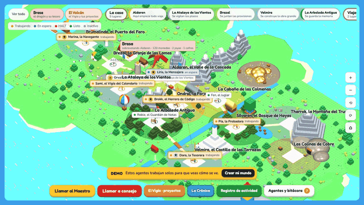

# Tierra de Agentes

**Give your AI agents a world to live in.**

A 3D fantasy map in toy-brick style where every AI agent is a little plastic figure. Its lantern shows what it is doing right now: working, waiting for you, stopped with a HALT, or done. A dragon guards the treasure and earns coins every time an agent finishes a task.

**[▶ Open the live demo](https://unadani.github.io/tierra-de-agentes/)** · [Leer en español](#español)



It is one HTML file and one JSON file. No build step, no server, no account.

## Start in one step

1. **Fork** this repository, then go to **Settings → Pages** and choose branch `main`, folder `/`.

Your world will be at `https://<your-user>.github.io/tierra-de-agentes/`. Until you add your own agents it opens the demo; the yellow **Crear mi mundo** button switches to your own, empty world.

To run it on your computer instead:

```bash
python3 -m http.server 8000
```

Then open <http://localhost:8000>. (Opening `index.html` with a double click does not work: browsers block it from reading `data/mundo.json`.)

## What you get

- **The map**: eleven places, each with its own scenery (a valley with a waterfall, a farm, a castle, a harbour with a lighthouse, a forge, forests, a volcano), linked by roads and a river.
- **Agents as toy figures**: each one has a character, a look, a craft and a state lantern. Coordinators carry a banner, and an orchestrator walks the whole map.
- **Live states**: `trabajando` (working), `esperando` (waiting for you), `halt`, `listo` (done) and `inactivo` (idle).
- **The Watcher's tower**: your projects, sorted by deadline. Each active project is a ring spinning around its flame.
- **The Chronicle and the activity log**: every step your agents report, by day.
- **Brasa, the dragon**: +10 coins per finished task, jewels and chests for bigger wins.
- **An editor in the page**: create, edit and delete agents without touching the JSON.

The interface is in Spanish for now. Labels are short, and the state colours speak for themselves.

## Connect any agent

Your agents report by writing to `data/mundo.json`. Anything that can run a command or edit a file can do it: a Claude skill, a cron job, a Python script, an n8n flow, a GitHub Action.

The easiest way is the helper script (standard library only):

```bash
python3 tools/reportar.py correo trabajando "Sorting the inbox" --tarea "Sort the inbox"
python3 tools/reportar.py correo esperando "Should I answer the invitation?"
python3 tools/reportar.py correo listo "Inbox sorted: 42 emails, 3 need you"
```

It updates the agent's state, adds a line to the log and, on `listo`, pays the dragon. If the agent does not exist yet, it creates one.

- **Locally**, the page re-reads the file every few seconds, so you watch it change live.
- **On GitHub Pages**, commit and push `data/mundo.json`; the page shows the change on the next load.

Prefer to write the JSON yourself? Set `agentes.<id>.estado` and add an entry to `eventos`:

```json
"20261101T120000Z-correo": { "agente": "correo", "estado": "listo", "nota": "Inbox sorted.", "ts": "2026-11-01T12:00:00Z" }
```

### Example: a Claude skill

[`examples/claude-skill/tierra-de-agentes/SKILL.md`](examples/claude-skill/tierra-de-agentes/SKILL.md) teaches Claude (Claude Code or claude.ai) to report every start, question, HALT and finish with `tools/reportar.py`. Copy the folder into your skills (for Claude Code, `~/.claude/skills/`), and your sessions show up on the map as they work.

### Inside claude.ai

If you publish the page as a claude.ai artifact, it uses the artifact's shared database instead of the JSON file. There you can also talk to each agent, call a council of agents, and ask the orchestrator for help. In the local copy those conversations are off.

## Make it yours

Everything lives in [`data/mundo.json`](data/mundo.json): places (`lugares`), teams (`salas`), agents (`agentes`), projects (`proyectos`), the log (`eventos`) and the dragon's treasure (`tesoro`). The Spanish section below has a full example of each record and the list of valid values. [`data/demo.json`](data/demo.json) is a complete world to copy from.

Changes you make in the page are saved in your browser. Use **Descargar mundo.json** at the bottom of the side panel to keep them, and replace the file in your fork.

## Credits

Inspired by the classic fantasy sagas, with a nod to J.R.R. Tolkien. This is a fan project with no connection to the Tolkien Estate, and it is not affiliated with or endorsed by any toy company. All names, places and designs in the world are original.

Built with [Three.js](https://threejs.org) (MIT) and the Fredoka and Nunito fonts (SIL Open Font License), loaded from their CDNs. Code under the [MIT license](LICENSE).

---

## Español

**Dale a tus agentes de IA un mundo donde vivir.**

Tierra de Agentes es un mapa de fantasía en 3D, en estilo bloques de juguete, donde cada agente de IA es una figurita de plástico. Su linterna muestra qué está haciendo: trabajando, esperando una respuesta tuya, detenido con un HALT o listo. Un dragón cuida el tesoro y suma monedas cada vez que un agente termina una tarea.

**[▶ Abre la demo](https://unadani.github.io/tierra-de-agentes/)**

Es un archivo HTML y un archivo JSON. No hay que compilar nada, ni tener servidor, ni crear cuentas.

### Empieza en un paso

1. Haz **fork** de este repositorio y, en **Settings → Pages**, elige la rama `main` y la carpeta `/`.

Tu mundo queda en `https://<tu-usuario>.github.io/tierra-de-agentes/`. Mientras no agregues agentes propios, se abre la demo. El botón amarillo **Crear mi mundo** te lleva a tu mundo vacío.

Para abrirlo en tu computador, sirve la carpeta con `python3 -m http.server 8000` y entra a <http://localhost:8000>. Con doble clic no funciona, porque el navegador no deja leer `data/mundo.json`.

### Conecta cualquier agente

Tus agentes reportan escribiendo en `data/mundo.json`. Sirve cualquier cosa que pueda correr un comando o editar un archivo: una skill de Claude, una tarea programada, un script o una GitHub Action. Lo más simple es el script incluido:

```bash
python3 tools/reportar.py correo trabajando "Ordena la bandeja" --tarea "Ordenar la bandeja"
python3 tools/reportar.py correo listo "Bandeja ordenada: 42 correos, 3 te necesitan"
```

El script cambia el estado del agente, anota el paso en la bitácora y, con `listo`, le paga al dragón. En tu computador, la página vuelve a leer el archivo cada pocos segundos y ves el cambio en vivo. En GitHub Pages, haz commit y push de `data/mundo.json`.

La skill de ejemplo está en [`examples/claude-skill/tierra-de-agentes/SKILL.md`](examples/claude-skill/tierra-de-agentes/SKILL.md). Cópiala en tus skills y Claude reportará cada inicio, pregunta, HALT y término.

### Cómo se guardan los cambios

1. Al abrir, la página lee `data/mundo.json`. Si el archivo dice `"mostrarDemo": true` y no has cambiado nada en este navegador, muestra la demo.
2. Lo que cambies en la página (agentes, proyectos, estados) se guarda en el `localStorage` de tu navegador. Solo lo ves tú, en ese navegador.
3. Para conservarlo o compartirlo, usa **Descargar mundo.json** (al final del panel) y reemplaza el archivo `data/mundo.json`.
4. **Volver a data/mundo.json** borra los cambios locales y recarga el archivo. **Ver la demo** vuelve a la demo.
5. También puedes forzar una vista con `?demo` o `?mundo` al final de la dirección.

### Cómo editar `data/mundo.json`

El archivo tiene siete colecciones. Cada una es un objeto cuyas claves son los identificadores.

| Colección | Qué guarda |
|---|---|
| `lugares` | Los lugares del mapa. |
| `salas` | Los equipos. |
| `agentes` | Los agentes. |
| `proyectos` | Los proyectos que ve el Vigía. |
| `eventos` | La bitácora: cada paso que reporta un agente. |
| `historia` | Entradas antiguas de la Crónica (opcional). |
| `tesoro` | El tesoro del dragón, en `tesoro.dragon`. |

#### Un lugar

```json
"valle": {
  "nombre": "Aldaren, el Valle de la Cascada",
  "rol": "Aquí empieza todo viaje",
  "descripcion": "Texto que aparece al pasar el mouse.",
  "tipo": "valle",
  "x": -16, "z": -10,
  "orden": 1,
  "suelo": "#FFF3C4",
  "territorio": "#FFD84A"
}
```

- `tipo` elige el paisaje que se dibuja alrededor: `valle`, `atalaya`, `prados`, `ciudad`, `forja`, `hayedo`, `puerto`, `montana`, `colmenar`, `arboleda` o `cobre`. Puedes inventar otros tipos: se dibujan sin paisaje propio.
- `x` y `z` ubican el lugar en el mapa (de oeste a este y de norte a sur). Si dos lugares chocan, la página los separa.
- `suelo` es el color de la plaza y `territorio`, el del halo de tierra que la rodea.

#### Un equipo

```json
"principal": { "nombre": "Equipo principal", "descripcion": "…", "lugar": "valle", "orden": 1, "color": "#1F62D0" }
```

#### Un agente

```json
"correo": {
  "personaje": "Liria, la Mensajera",
  "nombre": "Agente de correo",
  "descripcion": "Ordena la bandeja y deja borradores de respuesta.",
  "sala": "principal",
  "lugar": "valle",
  "fase": "Coordina",
  "actividad": "cartas",
  "estado": "trabajando",
  "tarea": "Resumir los correos sin leer",
  "voz": "Rápida y ordenada.",
  "coordinador": true,
  "apariencia": {
    "raza": "elfo",
    "mujer": true,
    "tunica": "#D62B20",
    "piernas": "#1B1D24",
    "pelo": "#3A2414",
    "peloLargo": true,
    "accesorios": ["orejas"]
  }
}
```

- `personaje` es el nombre que se ve en el mapa; `nombre` es su función.
- `estado`: `trabajando`, `esperando`, `halt`, `listo` o `inactivo`.
- `actividad` es el oficio que tiene a su lado: `escribir`, `leer`, `cartas`, `archivo`, `mapas`, `contar`, `herreria`, `carpinteria`, `cuero`, `telar`, `pintura`, `pociones`, `vigia`, `orbe`, `espejo`, `granja`, `jardin`, `colmenas`, `mineria`, `pesca`, `tiro`, `barco`, `bodega`, `roca` o `musica`.
- Rango: `coordinador` (estandarte dorado), `liderLugar` (estandarte de color) o `megaCoordinador` con `itinerante` y `recorreTodo` (quien camina por todo el mapa).
- `apariencia.raza`: `hombre`, `elfo`, `enano`, `mediano`, `criatura`, `arbol` o `aguila`.
- `apariencia.accesorios`: `barba`, `orejas`, `casco`, `corona`, `sombrero`, `hojas`, `baston`, `espada`, `hacha`, `arco`, `libro`, `anillo`.
- Otros campos de `apariencia`: `piel`, `pelo`, `barba`, `capa` (colores), y `peloLargo`, `mujer`, `falda`, `silla` (silla de ruedas) como `true`.

#### Un evento de la bitácora

```json
"20261101T120000Z-correo": { "agente": "correo", "estado": "trabajando", "nota": "Empieza a ordenar la bandeja.", "ts": "2026-11-01T12:00:00Z", "proyecto": "mudanza" }
```

### Si lo publicas en claude.ai

Si publicas la página como artifact de claude.ai, usa la base de datos del artifact en lugar del archivo. Ahí se activan las conversaciones con los agentes, el Concilio y el llamado al Orquestador. En la copia local esas conversaciones están apagadas.

### Créditos

Inspirado en las sagas de fantasía clásicas, con un guiño a J.R.R. Tolkien. Es un proyecto de fans sin relación con el Tolkien Estate, y no está afiliado a ninguna empresa de juguetes ni cuenta con su respaldo. Los nombres, lugares y diseños del mundo son propios.

Usa [Three.js](https://threejs.org) (MIT) y las fuentes Fredoka y Nunito (SIL Open Font License), que se cargan desde sus CDN. Código con [licencia MIT](LICENSE).
